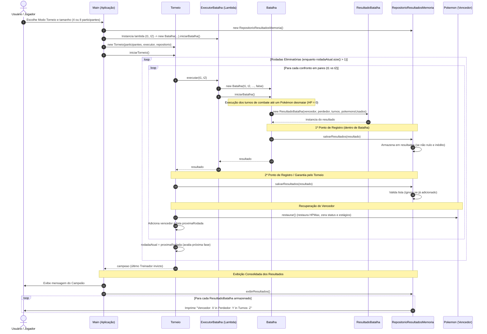

# PokeSal - Diagramas de Sequência (UML)

Este documento apresenta a análise de execução e os diagramas de sequência em português do projeto **PokeSal**, modelando com precisão o comportamento em tempo de execução das classes do sistema.

Os dois fluxos modelados são:
1. **Turno Completo de Batalha (`Batalha.iniciarBatalha`)**: Ciclo de vida de um turno, desde a leitura ambiental, tomada de decisão, cálculo de velocidade, resolução de ataques com dano/status/buffs, até os efeitos residuais de fim de turno.
2. **Fluxo de Registro do Resultado do Torneio (`Torneio.iniciarTorneio` e `RepositorioResultados`)**: Orquestração das chaves eliminatórias, execução das batalhas via interface funcional, persistência e deduplicação no repositório de resultados e exibição final do histórico.

---

## 1. Diagrama de Sequência: Turno Completo de Batalha

O diagrama abaixo detalha um ciclo iterativo completo do loop principal de `Batalha.iniciarBatalha()`.

```mermaid
sequenceDiagram
    autonumber
    actor Jogador as Treinador (Jogador)
    participant Batalha as Batalha (Controlador)
    participant ServicoTerreno as ServicoTerreno
    participant Terreno as Terreno Ativo
    participant Mochila as Mochila
    participant PkmnJogador as Pokemon (Jogador)
    participant PkmnOponente as Pokemon (Oponente)
    participant CalcDano as CalcDano
    participant Registro as RegistroBatalha

    Note over Batalha, ServicoTerreno: 1. Fase de Preparação do Ambiente e Clima
    Batalha->>ServicoTerreno: getClima()
    ServicoTerreno-->>Batalha: climaAtual (ex: CHUVA, SOL, NUBLADO)
    Batalha->>ServicoTerreno: getHorarioAtual()
    ServicoTerreno-->>Batalha: horarioAtual (ex: 22:50)
    Batalha->>ServicoTerreno: gerarTerreno()
    ServicoTerreno-->>Batalha: terrenoAtual (Asfalto, Poca ou Canteiro)

    opt Terreno mudou em relação ao anterior
        Batalha->>Batalha: Atualiza terreno ativo da batalha
    end

    Note over Jogador, Batalha: 2. Fase de Decisão do Jogador
    alt Jogador escolhe "1. Lutar"
        Jogador->>Batalha: Seleciona Golpe da lista
        Batalha->>PkmnJogador: podeAgir(gerador)
        alt Pokémon está paralisado e falha no teste de sorte
            PkmnJogador-->>Batalha: false (não consegue se mover)
        else Pokémon apto a agir
            PkmnJogador-->>Batalha: true
        end
    else Jogador escolhe "2. Mochila"
        Jogador->>Batalha: Seleciona Item (ex: Poção, CuraStatus)
        Batalha->>Mochila: usarItem(item, PkmnJogador)
        alt Item é Poção
            Mochila->>PkmnJogador: curar(20)
        else Item é CuraStatus
            Mochila->>PkmnJogador: curarStatus()
        end
        Batalha->>Batalha: Armazena itemUsadoTurno para registro
    else Jogador escolhe "3. Inspecionar"
        Jogador->>Batalha: Solicita status
        Batalha->>PkmnJogador: getHpAtual() / getHpMax()
        Batalha->>PkmnOponente: getHpAtual() / getHpMax()
    else Jogador escolhe "4. Terminar / Fugir"
        Jogador->>Batalha: Solicita fuga
        Note over Batalha: Se batalha selvagem, encerra retornando null
    end

    Note over Batalha, PkmnOponente: 3. Fase de Decisão da IA (Oponente)
    Batalha->>PkmnOponente: getGolpes()
    PkmnOponente-->>Batalha: List<Ataque>
    Batalha->>Batalha: Sorteia ataque da CPU (gerador.gerarDouble())

    Note over Batalha, CalcDano: 4. Resolução das Ações por Ordem de Velocidade
    Batalha->>PkmnJogador: getSpd()
    PkmnJogador-->>Batalha: spdJogador
    Batalha->>PkmnOponente: getSpd()
    PkmnOponente-->>Batalha: spdOponente

    alt spdJogador >= spdOponente (Jogador ataca primeiro)
        critical Execução do Ataque do Jogador
            Batalha->>Registro: registrarAtaque(ataqueJogador)
            opt Ataque ativa mudança de terreno
                Batalha->>Batalha: Altera terreno ativo
            end
            opt Ataque possui poder > 0
                Batalha->>CalcDano: calcularDano(ataque, PkmnJogador, PkmnOponente, Terreno)
                CalcDano-->>Batalha: danoCausado
                Batalha->>Registro: registrarDano(danoCausado)
                Batalha->>PkmnOponente: receberDano(danoCausado)
            end
            opt Ataque possui Buffs/Debuffs
                Batalha->>PkmnJogador: alterarAtk/Def/Spd()
                Batalha->>PkmnOponente: alterarAtk/Def/Spd()
            end
            opt Ataque inflige Efeito de Status (Queimado / Paralisado / Envenenado)
                Batalha->>PkmnOponente: setStatus(efeitoStatus)
                Batalha->>Registro: registrarEfeitoStatus(efeitoStatus)
            end
            Batalha->>Registro: registrarEfeitoTerreno(Terreno)
        end

        opt Oponente ainda com HP > 0
            critical Contra-ataque do Oponente
                Batalha->>PkmnOponente: podeAgir(gerador)
                alt Consegue se mover
                    Batalha->>Registro: registrarAtaque(ataqueOponente)
                    Batalha->>CalcDano: calcularDano(ataque, PkmnOponente, PkmnJogador, Terreno)
                    CalcDano-->>Batalha: danoCausado
                    Batalha->>Registro: registrarDano(danoCausado)
                    Batalha->>PkmnJogador: receberDano(danoCausado)
                    Batalha->>Registro: registrarEfeitoTerreno(Terreno)
                end
            end
        end

    else spdOponente > spdJogador (Oponente ataca primeiro)
        critical Execução do Ataque do Oponente primeiro
            Batalha->>PkmnOponente: podeAgir(gerador)
            Batalha->>Registro: registrarAtaque(ataqueOponente)
            Batalha->>CalcDano: calcularDano(...)
            Batalha->>PkmnJogador: receberDano(danoCausado)
        end
        opt Jogador ainda com HP > 0
            critical Contra-ataque do Jogador
                Batalha->>Registro: registrarAtaque(ataqueJogador)
                Batalha->>CalcDano: calcularDano(...)
                Batalha->>PkmnOponente: receberDano(danoCausado)
            end
        end
    end

    Note over Batalha, Terreno: 5. Efeitos de Fim de Turno
    opt Ambos Pokémons continuam com HP > 0
        Batalha->>PkmnJogador: aplicarDanoStatus() (Queimadura / Veneno)
        Batalha->>PkmnOponente: aplicarDanoStatus()
        Batalha->>Terreno: curaTerreno(PkmnJogador) (ex: Canteiro cura tipo PLANTA)
        Batalha->>Terreno: curaTerreno(PkmnOponente)
    end
    opt Item foi utilizado neste turno
        Batalha->>Registro: registrarItem(itemUsadoTurno)
    end
```

---

## 2. Diagrama de Sequência: Fluxo de Registro do Resultado do Torneio

O diagrama a seguir descreve a execução de um torneio completo, mostrando desde a criação do repositório em memória até a gravação e exibição consolidada dos resultados de cada combate.

---

## 3. Resumo dos Componentes Envolvidos

- [Main.java](file:///home/pablofranca/Documents/Universidade/4o%20semestre/Testes%20e%20Qualidade%20de%20Software/PokeSal/PokeSal-refactor/src/main/java/application/Main.java): Controla a interface por console, configuração inicial de dependências (`GeradorService`, `TerrenoService`, `CalcDano`, `RegistroBatalhaMemoria`, `RepositorioResultadosMemoria`), e iniciação dos modos Selvagem e Torneio.
- [Batalha.java](file:///home/pablofranca/Documents/Universidade/4o%20semestre/Testes%20e%20Qualidade%20de%20Software/PokeSal/PokeSal-refactor/src/main/java/utils/Batalha.java): Gerencia as regras de cada turno, velocidade dos Pokémons, invocação de golpes, cálculo de dano, aplicação de status/terreno, e salva o resultado final no repositório.
- [Torneio.java](file:///home/pablofranca/Documents/Universidade/4o%20semestre/Testes%20e%20Qualidade%20de%20Software/PokeSal/PokeSal-refactor/src/main/java/utils/Torneio.java): Orquestra o chaveamento em mata-mata (4 ou 8 participantes), delega combates ao `ExecutorBatalha`, salva os resultados no repositório e restaura a saúde dos vencedores entre as rodadas.
- [RepositorioResultadosMemoria.java](file:///home/pablofranca/Documents/Universidade/4o%20semestre/Testes%20e%20Qualidade%20de%20Software/PokeSal/PokeSal-refactor/src/main/java/utils/RepositorioResultadosMemoria.java): Implementação em memória que garante deduplicação de resultados (`!resultados.contains(resultado)`) e provê a listagem final.
- [RegistroBatalhaMemoria.java](file:///home/pablofranca/Documents/Universidade/4o%20semestre/Testes%20e%20Qualidade%20de%20Software/PokeSal/PokeSal-refactor/src/main/java/utils/RegistroBatalhaMemoria.java): Armazena os eventos atômicos de cada turno (ataque desferido, valor numérico do dano, status aplicado, terreno afetado e itens usados).
